  

  
  
  
  

 

I'm a full-stack developer in London who takes ideas all the way from a sketch to the App Store — mobile apps, web platforms, AI tools and games. When I'm not coding I'm painting mixed-media canvases, taking photos, or running my streetwear brand.

 

## ⚡ Tech stack

  
   
  

 

## 🚀 What I'm building

  
  
  
  
  
  

 

## 📈 Activity

  

  <picture>
    <source media="(prefers-color-scheme: dark)" srcset="https://raw.githubusercontent.com/seore/seore/output/github-snake-dark.svg" />
    <source media="(prefers-color-scheme: light)" srcset="https://raw.githubusercontent.com/seore/seore/output/github-snake.svg" />
    
  </picture>

  

